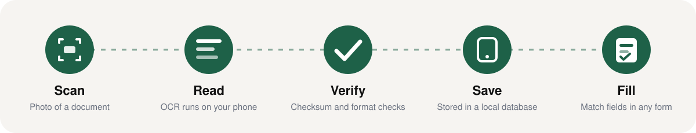

<div align="center">



<br />


**Your personal document companion.**
Scan an Aadhaar card once, keep the details on your phone, and fill forms without typing them again.

[✨ Features](#-features) · [🔄 How it works](#-how-it-works) · [🔐 Privacy](#-privacy) · [🧱 Architecture](#-architecture) · [🚀 Run it](#-run-it) · [🗺️ Roadmap](#-roadmap) · [👥 Team](#-team)

</div>

---

## 🌱 Why Bodhini

Filling a form in India usually means the same loop: find the card, squint at the number, type your name, date of birth and address again, and hope there is no typo. Online forms ask for the same details every time.

Bodhini reads the document for you, checks the details, keeps them on your phone, and matches them to the fields of the next form you open.

The name comes from the Sanskrit word for knowing and understanding.

---

## 🔄 How it works

<div align="center">

</div>

1. 📷 **Scan.** Point the camera at a document, or pick a photo from the gallery.
2. 🔎 **Read.** Text recognition runs on the phone with Google ML Kit.
3. ✅ **Verify.** The Aadhaar number goes through the Verhoeff checksum, dates and PIN codes go through format checks. Anything unsure is marked for review.
4. 💾 **Save.** You review the extracted details, fix anything that is off, and save them to your wallet.
5. 📝 **Fill.** Open a form, and Bodhini matches its fields to your saved details and builds a copy list you can paste from.

---

## ✨ Features

| | Feature | What it does |
|---|---|---|
| 📷 | **Document camera** | Guide frame in ID card ratio, flash toggle, gallery import, clear states for permission denied or camera unavailable. |
| 🧠 | **On-device OCR** | Google ML Kit text recognition. The photo is not sent anywhere to be read. |
| 🪪 | **Aadhaar extraction** | Handles the PVC card front and the e-Aadhaar letter. Reads name, date of birth, gender, number, address, PIN and care-of name. |
| 🔢 | **Checksum validation** | Aadhaar numbers are checked with the Verhoeff algorithm. VID and enrolment numbers are ignored, not mistaken for the Aadhaar number. |
| 🕶️ | **Masked by default** | Aadhaar numbers show only the last four digits. A show and hide eye reveals the rest when you choose to. |
| 🗂️ | **Wallet** | Saved documents as colored cards with a detail screen, delete with confirmation, and an empty state that points to the scan button. |
| 📝 | **Smart form fill** | Reads the labels on a form, matches them to your saved fields, and marks each one as matched, needs review, or missing. Signature and declaration fields are always skipped. |
| 📋 | **Copy list** | A clean list of values to copy into the form, with a Copied confirmation. |
| 💬 | **Long-press help** | Hold any button for a moment and a short tip explains what it does. |
| 🌗 | **Light and dark** | System, light and dark modes with a smooth cross-fade. |
| 🌐 | **Three UI languages** | English, বাংলা and हिन्दी for every screen. |
| 🧩 | **Made for low-end phones** | Transform and opacity animations only, virtualized lists, no blur effects, reduce-motion setting. |

> [!NOTE]
> Text recognition is tuned for **English** documents today. The interface itself is available in English, Bengali and Hindi. Hindi and Bengali OCR are on the [roadmap](#-roadmap).

### 🚧 Visible in the app, not built yet

These show a friendly "Coming soon" sheet instead of pretending to work.

| Feature | Status |
|---|---|
| 🎙️ Voice assistant | Under development |
| 🤖 AI Assistant and Fill with AI | Planned |
| ☁️ Cloud backup | Planned |
| 🔒 App lock | Planned |
| 📤 Share a document | Planned |

---

## 🔐 Privacy

Bodhini is built so that your documents have no reason to leave your phone.

- 📍 Text recognition runs on the device.
- 🗄️ Saved documents live in a local database on the phone.
- 🕶️ Aadhaar numbers are masked everywhere except where you choose to reveal them.
- 🪵 Field values are never written to logs.
- 🧹 **Delete all data** in Settings removes everything the app has saved.

> [!IMPORTANT]
> Never commit real documents, photos of cards, or real Aadhaar numbers to this repository. All tests use made-up data.

---

## 🧱 Architecture

Bodhini follows a ports and adapters layout. The screens depend on small interfaces, and the real work (OCR, storage, matching, validation) plugs in behind them.

```text
 ┌──────────────────────────────────────────────────────────┐
 │  src/app          screens and routes (expo-router)       │
 │  src/components   UI kit, motion helpers, tab bar        │
 │  src/state        app context and preferences            │
 └───────────────┬──────────────────────────────────────────┘
                 │ uses
 ┌───────────────▼──────────────┐     ┌──────────────────────┐
 │  src/composition             │────▶│  src/domain          │
 │  wires services together    │     │  types and ports     │
 └───────────────┬──────────────┘     └──────────▲───────────┘
                 │ builds                         │ implements
 ┌───────────────▼────────────────────────────────┴─────────┐
 │  src/infrastructure                                      │
 │  vision/ocr   ML Kit wrapper, Aadhaar and form analysis  │
 │  validation   Verhoeff, dates, PIN, document checks      │
 │  matching     form label to saved field matcher          │
 │  storage      SQLite document repository                 │
 │  export       copy list builder                          │
 │  voice        speech service                             │
 └──────────────────────────────────────────────────────────┘
```

<details>
<summary><b>📁 Project structure</b></summary>

```text
Bodhini/
├── assets/
│   ├── images/            logo marks, app icon, hero image
│   └── readme/            animated README graphics
├── scripts/               test runner helpers
├── src/
│   ├── app/               routes: onboarding, tabs, scan, forms, documents
│   ├── components/        ui, motion, navigation
│   ├── composition/       service wiring
│   ├── domain/            document and form types, ports
│   ├── i18n/              English, Bengali, Hindi strings
│   ├── infrastructure/    ocr, validation, matching, storage, export, voice
│   ├── state/             app context
│   └── theme/             tokens and theme provider
├── test/                  synthetic backend and static frontend tests
├── app.json               Expo config
└── eas.json               EAS build profiles
```

</details>

---

## 🧰 Tech stack

| Layer | Tools |
|---|---|
| 📱 App | Expo SDK 58, React Native 0.88, React Compiler, TypeScript |
| 🧭 Navigation | expo-router |
| 🎞️ Motion | react-native-reanimated, react-native-gesture-handler |
| 📷 Camera and images | expo-camera, expo-image-picker, expo-image |
| 🔎 OCR | @react-native-ml-kit/text-recognition |
| 🗄️ Storage | expo-sqlite |
| 🎨 Icons | lucide-react-native |
| 📋 Clipboard and speech | expo-clipboard, expo-speech |
| 🏗️ Build | EAS Build |

---

## 🚀 Run it

> [!WARNING]
> **Expo Go does not work with Bodhini.** The app uses native modules (ML Kit text recognition), so it needs a development build or the APK from EAS.

**Prerequisites:** Node.js 20 or newer, an Android phone, and a free [Expo account](https://expo.dev) for cloud builds.

### 📦 Install

```text
git clone https://github.com/QuantumSenpai/Bodhini.git
cd Bodhini
npm install
```

### 📲 Build an installable APK (no Android Studio needed)

```text
npx eas-cli@latest login
npx eas-cli@latest build --platform android --profile preview
```

The build runs on Expo's servers. When it finishes you get a link and a QR code. Open it on your phone and install the APK. You may need to allow installs from your browser once.

### 🧑‍💻 Develop against a dev client

Install a development build on the phone once, then:

```text
npx expo start --dev-client
```

Open the app on the phone and connect to the Metro server shown in the terminal.

### 🧪 Checks

```text
npx tsc --noEmit
npx tsx test/backend-b.synthetic.test.ts
npx tsx src/infrastructure/validation/validation.smoke.ts
npx tsx src/infrastructure/vision/ocr/aadhaarExtract.smoke.ts
```

All test data is synthetic. Please keep it that way.

---

## 🧪 Try it with a sample

1. Open **Forms** and choose the **Sample form**. It asks for a full name, an Aadhaar number, a signature and a declaration.
2. Tap the **+** button and scan a document, or pick a photo from the gallery. Use a made-up or sample card for demos.
3. Review the extracted details and save them to your wallet.
4. Go back to the sample form. Name and Aadhaar number fill from your wallet, and signature and declaration are left for you.

---

## 🌐 Language support

| | English | বাংলা | हिन्दी |
|---|:---:|:---:|:---:|
| App interface | ✅ | ✅ | ✅ |
| Document OCR | ✅ | 🔜 | 🔜 |
| Long-press tips | ✅ | ✅ | ✅ |

---

## 🗺️ Roadmap

- [x] On-device OCR with ML Kit
- [x] Aadhaar extraction for card and e-Aadhaar layouts
- [x] Verhoeff checksum and masked display
- [x] Wallet, detail screen and delete
- [x] Form analysis, matching and copy list
- [x] Light and dark themes, three interface languages
- [x] Long-press help on controls
- [ ] Hindi (Devanagari) OCR
- [ ] Bengali OCR
- [ ] More document types: PAN, birth certificate, marksheets
- [ ] PDF form import
- [ ] Voice assistant
- [ ] Optional encrypted cloud backup
- [ ] App lock with biometrics
- [ ] iOS build

---

## 👥 Team

<div align="center">


### Team NexBytes

Built at **AKI HACKS x Hacktoberfest Hack Day, Kolkata** on 31 October 2026.

</div>

| Member | Role | GitHub |
|---|---|---|
| **Krishnendu Adak (Kisu)** | Team lead, OCR, extraction, integration | [@QuantumSenpai](https://github.com/QuantumSenpai) |
| **Abirbhab Dasgupta** | Frontend and app flow | [@abirbhab-dasgupta](https://github.com/abirbhab-dasgupta) |
| **Manish** | Backend data engine | |

---

<div align="center">


**Made by Team NexBytes**
© 2026 Team NexBytes. All rights reserved.

</div>
